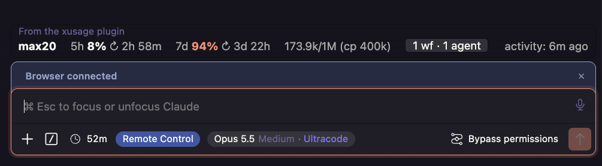
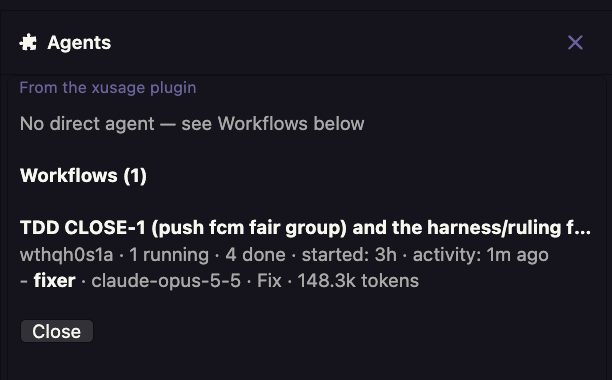
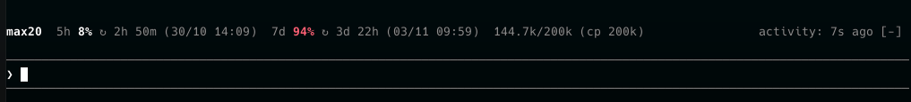
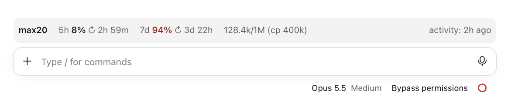

# xusage

A thin band above the prompt that shows **plan usage, quota resets, context and agent activity** for Claude Code — plus an **Agents** pane for subagents and workflows.

Built for Claude Code builds with module support (the `modules` entry in `hooks/hooks.json`). Works in the terminal CLI, the desktop app and the IDE extension.



## Why this exists

Claude Code's built-in agent UI does not cover background work well:

- **The running-agent list can be wrong or empty.** While a workflow runs in the background, its agents never appear in the agent API, and a finished background agent can stay listed as `waiting` for the rest of the session. xusage reads the engine's own agent metadata and workflow state instead, so a quiet list means the session is actually quiet.
- **A conversation has no liveness signal.** When everything runs in the background, the conversation looks idle even while it is working. `activity` is xusage's own indicator: the age of the newest event in the session transcript, an agent transcript or a workflow journal.
- **Workflow state is scattered.** The Agents pane gathers the title, task id, progress, start time, last activity and every running agent of each workflow into one compact view, so you can see what is running and where it is.

## Features

### Plan and quota

- **Live plan label** — from your OAuth credentials in Claude account mode, from the proxy's quota headers in proxy mode: `max20`, `max5`, `max6.5`, `team6.5`, etc. It is resolved independently of quota, so it stays correct when usage is served from cache or held in a `429` backoff.
- **Quota windows** — `5h`, `7d` (plus the opus/sonnet weekly windows when present) with percent used, a reset countdown and, when the band is wide enough, the local reset time: `5h 8% ↻ 2h 58m (30/10 14:09)`.
- **Color at a glance** — 70% warns, 90% errors.
- **Silent failures** — quota errors never add retry text, icons or buttons. On a `429` the last known good windows stay visible until the retry time; other failures show an empty window set. Retries continue in the background.

### Context

- Current context against the window: `173.9k/1M`, with `M` for millions.
- The auto-compact window when it is numeric: `(cp 400k)`. Honors `CLAUDE_CODE_AUTO_COMPACT_WINDOW`, per-model `autoCompactWindow`, `autoCompactEnabled` and the `DISABLE_AUTO_COMPACT` / `DISABLE_COMPACT` flags. The displayed value is clamped to 100k–1M and to the context window. Hidden when no numeric window applies, including `"auto"`, which Claude Code resolves internally.

### Agents and workflows

- **Badge** — `1 wf · 1 agent` in the band, counting live direct agents plus the agents currently running inside workflows. Click it to open the pane; if a pane cannot be placed, a condensed summary is shown as a toast.
- **Direct agents** — every live running or waiting subagent and teammate of the session: name, id, kind, model, status, tokens, start time and last activity.
- **Finished agents disappear** — a background agent that Claude has finished is hidden even though the engine still reports it as `waiting`.
- **Running workflows** — the title comes from the workflow script's own description; the id is the **task id the conversation uses** (e.g. `wft7bs6ek`) when its launch result is found, otherwise the internal run id. Each run shows its progress, start time and last activity, and each agent currently running inside it shows label, model, phase and tokens.
- **Activity age** — the band always shows when the conversation last did something, using the newest transcript, agent or workflow file, so a conversation that looks idle but has background agents running is visibly alive.

**Agents pane** — opened by clicking the `N wf · M agents` badge.



**Band in the terminal CLI**



**Band in the desktop app**



## Installation

### As a plugin (recommended)

```text
/plugin marketplace add xmannv/xusage-for-claude-mods
/plugin install xusage@xusage-for-claude-mods
```

Then reload plugins (`/reload-plugins`) or restart Claude Code.

These commands load the band only in a Claude Code build with the module hooks API. Standard upstream Claude Code installs the plugin but never shows the band.

### Manual

```sh
git clone https://github.com/xmannv/xusage-for-claude-mods.git
cp -R xusage-for-claude-mods/xusage ~/.claude/skills/xusage
```

On Windows (PowerShell):

```powershell
git clone https://github.com/xmannv/xusage-for-claude-mods.git
Copy-Item -Recurse xusage-for-claude-mods\xusage "$env:USERPROFILE\.claude\skills\xusage"
```

Restart Claude Code. Modules load once per window, so an already-running session keeps the old code until it is reloaded.

### Requirements

- A Claude Code build with module support (the band/pane `modules` API).
- macOS, Linux or Windows.
  - macOS / Linux: the module invokes Unix absolute paths (`/usr/bin/security`, `/usr/bin/sqlite3`, `/bin/mv`, `/bin/mkdir`, `/bin/rmdir`, `/usr/bin/grep`, `/usr/bin/tail`, `/usr/bin/head`, `/usr/bin/find`).
  - Windows (detected from `OS=Windows_NT`): nothing to install. File locks and the cache rename go through `%SystemRoot%\System32\cmd.exe`; transcripts and journals are read through the host when they are 4 MiB or smaller, and through Windows PowerShell 5.1 (built in) when larger, with the result kept until the file changes. The home directory comes from `USERPROFILE`, so an MSYS `HOME` set by Git Bash does not misplace `.claude`.
- Claude account mode prefers the macOS Keychain item `Claude Code-credentials` and falls back to `$CLAUDE_CONFIG_DIR/.credentials.json` (`~/.claude` by default). On Windows and Linux only the file is read.
- Proxy mode needs `sqlite3`: `/usr/bin/sqlite3` on macOS (built in) and Linux (the `sqlite3` package); on Windows `sqlite3.exe` on `PATH` (e.g. `winget install SQLite.SQLite`).

## Configuration

| Variable / file | Default | Purpose |
| --- | --- | --- |
| `USAGE_BAND_SOURCE` | auto | `claude` or `proxy`. By default, a non-Anthropic `ANTHROPIC_BASE_URL` (environment or `settings.json`) selects `proxy`. |
| `USAGE_BAND_DB` | see below | Path to the proxy usage database. |
| `$CLAUDE_CONFIG_DIR/.usage-band` | `~/.claude/.usage-band` | Write `off` to hide the band. Any other content (or no file) shows it. |
| `$CLAUDE_CONFIG_DIR/xusage-cache.json` | `~/.claude/xusage-cache.json` | Shared usage cache: 30s TTL for good data, 5s after a failure, last known good kept on `429`. |

Proxy database defaults:

1. `~/Library/Application Support/com.cpa.gui/usage-records/usage.db` (Windows: `%APPDATA%\com.cpa.gui\usage-records\usage.db`)
2. `~/.cli-proxy-api/usage.db`

## Where the data comes from

- **Claude account** — `GET https://api.anthropic.com/api/oauth/usage` with the OAuth token from the macOS Keychain or `$CLAUDE_CONFIG_DIR/.credentials.json`. The plan comes from `subscriptionType` + `rateLimitTier`.
- **Local proxy** — the newest EasyCLIProxyAPI usage record, which carries the upstream quota headers (`X-Codex-*`). The band reads it with `sqlite3`.
- **Agents and workflows** — Claude Code does not expose workflows through the plugin API, so the band reads the session's own files under `$CLAUDE_CONFIG_DIR/projects/<project>/<session>/`: `subagents/agent-*.jsonl` (+ `.meta.json`), `subagents/workflows/<run>/journal.jsonl`, `subagents/workflows/<run>/agent-*.jsonl`, `workflows/<run>.json`, `workflows/scripts/*.js` and the session transcript `<session>.jsonl` (for task ids).

Usage is cached across all Claude Code windows through a lock file, so simultaneous windows make one request instead of one each. A `429` without `Retry-After` backs off 5 minutes; a valid `Retry-After` (seconds or HTTP date) is honored, capped at 1 hour.

## Development

Requires Bun. From the repository root:

```sh
cd xusage
bun test
```

```text
xusage/
  .claude-plugin/plugin.json   plugin manifest
  hooks/hooks.json             registers the band module
  hooks/band/register.tsx      band + agents pane
  tests/usage.test.ts          rendering and data tests
```

The tests transpile the real module and render the real pane against fixture files, so they cover the display order, finished-agent detection, workflow titles/task ids, token counts and model names.

## Notes

- The workflow and agent views depend on Claude Code's private on-disk layout. If a release changes it, workflows silently disappear from the pane rather than showing wrong data.
- Model and tokens are read from the last 256 KB of each agent transcript. Activity comes from agent and workflow file mtimes and the last timestamped line of the session transcript. A transcript ending in a very large tool output can leave model or tokens blank; values are never borrowed from another agent or from the session.
